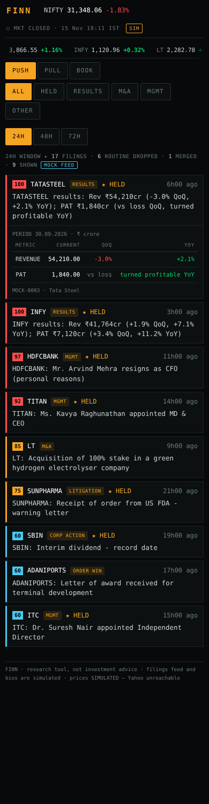
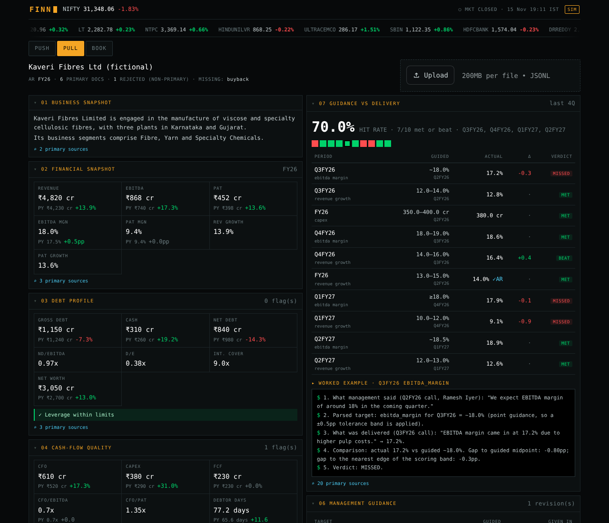

# FINN — Investment Agent for Indian Stocks

A mobile-first research terminal for NSE/BSE equities with two modes:

- **Push** — a 24-hour digest of corporate filings that drops routine compliance paperwork, ranks material announcements (results, M&A, management changes), extracts QoQ/YoY numbers and generates push-ready headlines.
- **Pull** — structured research built **only from primary sources** (annual reports and earnings-call transcripts), with every number traceable to a quote, document and page.

<p align="center">
  
  &nbsp;
  
</p>

## Quick start

```bash
git clone https://github.com/rish123-456/finn-investment-agent.git
cd finn-investment-agent
pip install -r requirements.txt
streamlit run finn_app.py
```

If Yahoo Finance is unreachable the app falls back to simulated prices automatically (shown as a **SIM** badge). To force offline mode:

```bash
FINN_OFFLINE=1 streamlit run finn_app.py
```

## Project structure

| File | What it does |
|---|---|
| `finn_data.py` | 20-stock NSE universe across 16 sectors, mock portfolio, end-of-day prices via `yfinance`, indicators (SMA 20/50/200, EMA 12/26, volume ratio, returns, 52-week high), portfolio P&L and sector weights |
| `finn_push.py` | Push backend: 24h window filter, routine-filing filter, rule-based classification, priority scoring, dedupe, results QoQ/YoY extraction, management-change parsing, mock bio snippets |
| `finn_pull.py` | Pull backend: parses annual reports and concall transcripts into 8 research categories, enforces primary sources, scores management guidance against delivery |
| `finn_app.py` | Streamlit UI with a terminal look — PUSH / PULL / BOOK views, responsive from phone to desktop |
| `.streamlit/config.toml` | Dark theme for Streamlit's built-in controls |

Each backend module also runs on its own:

```bash
python finn_data.py --period 2y   # prices + indicators -> data/
python finn_push.py --hours 24    # filings digest -> data/push_digest_*.json
python finn_pull.py               # research JSON for the sample company -> data/research.json
```

## Pull research categories

1. **Business snapshot** — what the company does, its segments
2. **Financial snapshot** — revenue, EBITDA, PAT, margins, growth vs prior year
3. **Debt profile** — gross/net debt, net debt/EBITDA, D/E, interest coverage (flags above 3x leverage or below 3x cover)
4. **Cash-flow quality** — CFO vs EBITDA and PAT, free cash flow, receivable days
5. **Capital allocation** — capex, dividends, payout ratio, buybacks, acquisitions
6. **Management guidance** — outstanding forward-looking statements and revisions (management speakers only)
7. **Guidance vs delivery** — last 4 quarters scored as beat / met / missed, hit rate, and a step-by-step worked example; full-year figures cross-checked against the audited annual report
8. **Governance & red flags** — audit opinion, emphasis of matter, contingent liabilities, related-party transactions, promoter pledges

Non-primary sources (e.g. broker notes) are rejected and listed. Analyst questions on calls are never treated as guidance. Anything not found is reported as missing rather than guessed.

To run Pull on your own documents, upload a `.jsonl` file in the app (or pass `--input`), one chunk per line:

```json
{"doc_id": "ACME-AR-FY26", "source_type": "annual_report", "company": "Acme Ltd", "period": "FY26", "page": 38, "text": "Revenue from operations: ₹4,820 crore (FY25: ₹4,230 crore)"}
{"doc_id": "ACME-CC-Q2FY27", "source_type": "concall_transcript", "company": "Acme Ltd", "period": "Q2FY27", "speaker": "CFO Name", "speaker_role": "management", "text": "For Q3 FY27, we expect revenue growth of 13-15%."}
```

## What is simulated

- **Filings feed** in Push mode is generated mock data; the people named in it are fictional.
- **Management bios** are synthetic templates, clearly marked `MOCK` — replace them with a real profile source before showing to users.
- **Sample company** in Pull mode ("Kaveri Fibres Ltd") is fictional.
- **Portfolio** holdings and average costs are placeholders.

## Roadmap

- Live NSE/BSE corporate-announcements fetcher to replace the mock filings
- PDF table extraction for real results filings and annual reports
- Optional LLM extraction pass per research category, keeping the quote-for-every-number rule
- Scheduled post-market refresh (after 3:30 PM IST)

---

*FINN is a research tool, not investment advice.*
